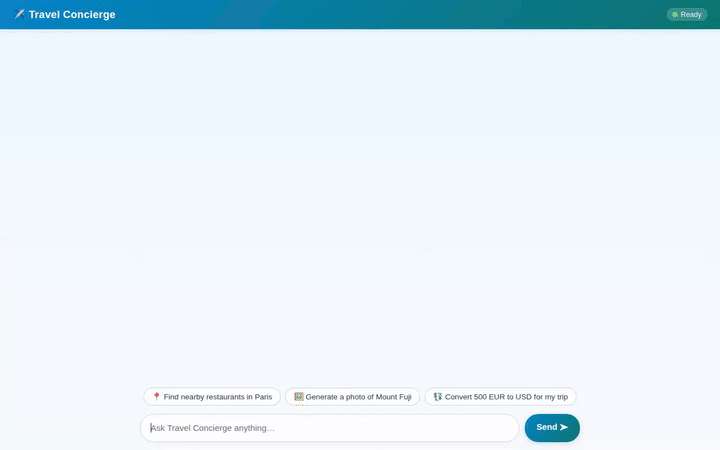

# Travel Concierge — AI Travel & Destination Assistant



**Travel Concierge** is an AI-powered travel assistant built on Google's Agent Development Kit (ADK) and Vertex AI Agent Engine. It helps travelers discover destinations, search nearby places with real Google Maps data, convert currency, look up landmark summaries, generate custom destination images and short videos, and remember user preferences across sessions.

---

## 🌟 Implemented Features & Architecture

### 1. 🧠 Persistent Long-Term Memory (Vertex AI Memory Bank)
- **`PreloadMemoryTool` & `VertexAiMemoryBankService`**: Automatically preloads and saves user preferences, dietary restrictions, and travel facts across separate chat sessions.
- **Allergy & Preference Guardrails**: Automatically respects remembered dietary restrictions when suggesting venues or dining options.

### 2. 🗄️ Destination Catalog (Google Cloud Firestore)
- **`list_destinations`**: Fetches curated destination entries from the Cloud Firestore `destinations` collection.
- **`get_destination_details`**: Retrieves comprehensive information for a destination, including country, description, tags, and best time to visit.
- **`add_destination`**: Allows users to add new travel destinations directly into the Firestore database.

### 3. 🗺️ Location & Venue Intelligence (Google Maps & Places APIs)
- **`geocode_address`**: Converts street addresses or landmark names into latitude/longitude coordinates using Google Maps Geocoding API.
- **`search_nearby_places`**: Finds nearby restaurants, cafes, hotels, or museums with rating details, addresses, and real Google Places photos.
- **`get_place_summary`**: Retrieves Wikipedia summaries and representative images for world landmarks.

### 4. 🎨 AI Media Generation & Cloud Storage (Vertex AI Imagen 3 & Gemini Omni)
- **`generate_destination_image`**: Uses Imagen 3 (`imagen-3.0-generate-002` on Vertex AI) to generate high-resolution destination photos, uploads them to a public Google Cloud Storage bucket, and returns public HTTPS image URLs.
- **`generate_destination_video`**: Uses Google's Omni model (`gemini-omni-flash-preview` on Vertex AI in the `global` region) to generate short destination video clips, uploads them to Cloud Storage, and registers them as Playground artifacts.

### 5. 🧮 Sandbox & Utilities
- **`convert_currency`**: Performs real-time currency conversions using live exchange rates.
- **Agent Engine Code Execution Sandbox**: Executes Python calculations securely inside Vertex AI Agent Engine sandbox containers.
- **`get_weather` & `get_current_time`**: Provides simulated weather reports and timezone lookups.

### 6. 📱 Interactive A2UI Cards & Custom Chat UI
- **A2UI Protocol**: Generates structured card layouts (Cards, Columns, Rows, Text, and Images) rendered directly by the chat frontend.
- **FastAPI Proxy & Web UI**: A lightweight, responsive chat interface (`frontend/main.py` and `frontend/static/index.html`) communicating over the A2A protocol.

---

## 🛠️ Google Cloud Services Integrated

| Service | Purpose in App |
|---|---|
| **Vertex AI Agent Engine** | Remote reasoning engine runtime & secure Python sandbox execution |
| **Vertex AI Memory Bank** | Cross-session long-term memory for user facts and dietary preferences |
| **Google Cloud Firestore** | Persistent NoSQL database store for the travel destination catalog |
| **Google Cloud Storage (GCS)** | Public media storage bucket for generated images and videos |
| **Vertex AI Imagen 3** | High-fidelity destination image synthesis (`imagen-3.0-generate-002`) |
| **Vertex AI Gemini Omni** | Short video generation (`gemini-omni-flash-preview`) |
| **Google Maps & Places APIs** | Geocoding and venue search with photos and ratings |

---

## 🚀 Local Setup & Running Instructions

### Prerequisites
- Python 3.10+
- Google Cloud SDK (`gcloud`) authenticated to your GCP project
- Active deployment on Vertex AI Agent Engine

### 1. Install Dependencies
```bash
cd frontend
pip install -r requirements.txt
```

### 2. Set Environment Variables
Set your Agent Engine resource name (from `deployment_metadata.json`) and agent directory:

```bash
export AGENT_ENGINE_RESOURCE_NAME="projects/<PROJECT_NUMBER>/locations/<REGION>/reasoningEngines/<ENGINE_ID>"
export AGENT_DIRECTORY="app"
```

### 3. Launch the Local Proxy Server
```bash
python main.py
```
The server will start on port `8080`. Open your browser to the local address output in your terminal to interact with Travel Concierge.
